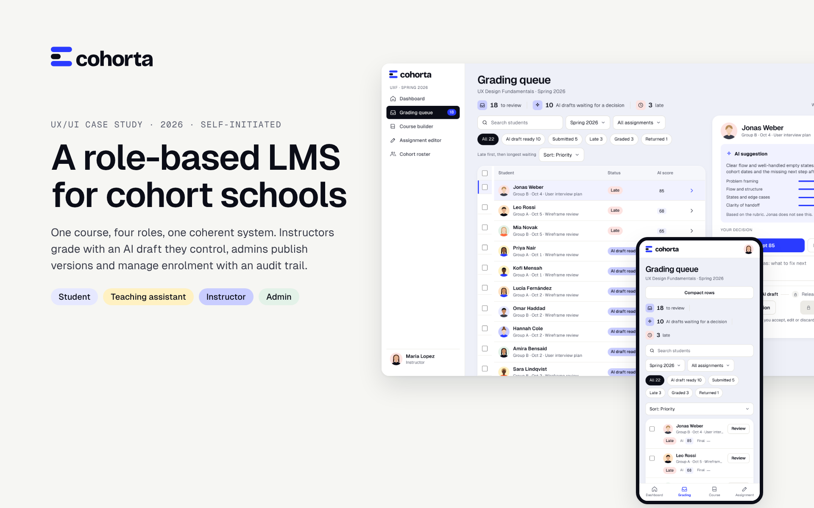

# Cohorta

A role-based LMS for cohort-based online schools. UX/UI and front-end by **Tania Aisen**.

**Live demo:** https://tanyaaisen07-uiux.github.io/cohorta
**Figma:** https://www.figma.com/design/J4J6upc1wrEXRMm6xLjisE

## Project type

Self-initiated Product Design case study. All names and data in the demo are fictional.

## Approach

The product direction was developed through scenario-based design and product hypotheses. I mapped the needs of students, instructors and administrators, then explored how role-based permissions, grading workflows, course management and product states could support their tasks.

The concepts and workflows represent design hypotheses, not findings from primary user research.

## Case study

All 14 case images are in [`/case`](case).

## The problem

Online schools run the same course for several cohorts at once. Students, instructors, teaching assistants and admins all work in one product, but each role needs a different home, different permissions and a different idea of "what to do next".

## What the demo shows

| Role | Key flows |
|---|---|
| Student | One finished flow: course home with the next step, lesson marked as done, assignment (choose a file, then submit), what happens next, grades with a grade the instructor released in the same session. Also the locked lesson |
| Instructor | Grading queue with filters and bulk actions, quick review panel, full grading view with AI draft, course builder, assignment editor, roster |
| Teaching assistant | The same grading tools scoped to Group A, in a simpler view: queue without the Group column, quick review over the queue, grading view, group roster. Work from other groups opens as No access, and a released grade is locked with a note that only the instructor can change it |
| Admin | Overview, course review and publishing, cohort scheduling, enrolments with bulk pause and undo, users and roles with an audit log |

Use the bar at the top to switch role and page state: normal, empty, loading, error, no access, long data.

## Key UX decisions

- **Queue first, not inbox.** Instructors grade from one queue sorted by Priority (late work first, then whatever has waited longest), with a quick review panel so they never lose their place.
- **AI drafts a grade, a person releases it.** The AI draft is visibly marked, can be accepted, edited or discarded, and nothing reaches a student without a human release. Release stays locked until the draft is accepted, edited or discarded, a discarded draft takes its score with it, and every release says in the audit log whether AI helped. A release can be undone for a few seconds.
- **Versions protect running cohorts.** Course edits go into a new version; a running cohort keeps its version until an admin pushes the update.
- **Every sensitive action is logged.** Role changes, pushes and bulk actions land in the audit log; bulk actions have undo.
- **Responsive by rule, not by shrinking.** Tablet splits grading into Document and Assessment tabs; mobile turns tables into compact rows with a fixed bulk bar.

## Motion

Motion appears only where it explains an action or a state: the review panel slides in once and only fades its content when you move to the next submission; toasts fade in and out and update in place; the bulk bar rises with the first selected row and the rows an action changed get a short highlight; buttons change colour on hover and press and show a spinner while an action runs; skeletons appear only while data loads. Micro transitions take 150 ms, panels 200 ms. Nothing pulses, bounces or animates between pages, and `prefers-reduced-motion` turns every movement into an instant change.

## Visual layer

The original white sidebar with the cobalt logo, content on a light canvas, and white cards with a barely visible shadow. People are drawn as illustrated, faceless avatars generated from their names, so long-data names get a stable drawing too. For instructors on screens 1400 px and wider the quick review is a column next to the grading queue: any row opens in one click and the queue is never dimmed. Below 1400 px, and always for a teaching assistant, it slides over the queue; on a phone review is a separate step. Release has three visible states: locked until a decision on the AI draft, ready with a preview of what the student will see, and released with a few seconds to undo.

## Responsive experience across roles

Cohorta is designed as a responsive LMS, adapting learning and teaching workflows to different screen sizes. Student learning is optimized for mobile, while complex grading and administration workflows prioritize desktop usability.

- **Student, mobile first.** The whole flow works on a phone: next lesson, assignment, submission and the released grade. Every phone page keeps space above the bottom navigation, so the last card is never hidden.
- **Instructor.** On a phone the queue and the review are separate steps with a clear way back; on a wide screen the review is a column next to the queue.
- **Admin, desktop first.** Bulk work, tables and roles are built for a desktop. On a phone tables become stacked rows and nothing scrolls sideways.

Checked at 360, 390 and 430 px for phones, 1024 for tablets and 1440 for desktop, including the long data, loading and error states.

## Long content

The **Long data** state swaps the sample data for a stress set: 200 enrolments and 198 submissions, 30 to 40 character names with diacritics, long emails, course and cohort titles, scopes and feedback. Rules it checks:

- One line cells (email, course, cohort, owner) truncate with an ellipsis and keep the full text in a tooltip; names never push the status, score or actions out of the row.
- Long text that carries meaning (feedback, scope, audit entries) wraps instead of truncating.
- At 1024 px secondary columns hide before anything truncates to a few letters.
- At 390 px tables turn into stacked rows; wide reference tables scroll inside their card, never the page.

## Accessibility

Text and status tags meet WCAG AA (status tags 12.6 to 17.2:1, primary button 6.6:1, secondary text 6.2:1). Focus states are visible, hit areas are at least 32 px, and motion respects `prefers-reduced-motion`.

## Stack

Plain HTML, CSS and JavaScript, no build step. Type: Geist. Brand assets are in `/brand`.

## Contact

- Portfolio: https://tania-aisen.framer.website/
- LinkedIn: https://www.linkedin.com/in/tania-aisen
- Behance: https://www.behance.net/tanyaaisen
